  

  
  
  

  En <strong>M2 Ingénierie Logicielle</strong> (ILSEN / CMI) et en alternance chez <strong>CBA Informatique Libérale</strong>, je conçois les passerelles natives mobiles (Kotlin / Swift), la communication BLE et le pilotage firmware de dispositifs de santé connectés.

---

### 🛠️ Tech Stack

| Domaine                       | Technologies & Outils                                                                                                              |
| :---------------------------- | :--------------------------------------------------------------------------------------------------------------------------------- |
| **Mobile**              | `Kotlin` `Swift` `Java` `Capacitor` `Ionic` `Angular` `React` `TypeScript`                                         |
| **Hardware & IoT**      | `Bluetooth LE` `STM32` `Nordic nRF` `DFU / Bootloader` `ISO 7816 / APDU` `Raspberry Pi` `C++`                        |
| **Systèmes & Backend** | `Rust` `Jakarta EE` `GraphQL` `Prisma ORM` `RxDB (Offline-First)` `MySQL`                                              |
| **CI/CD & DevOps**      | `GitLab CI/CD` `Fastlane (Ruby)` `Firebase App Distribution` `TestFlight` `Docker`                                       |
| **Tooling & IA**        | `Gemini & Antigravity` `Claude Code CLI` `Multi-Agentic Workflows` `Model Context Protocol (MCP)` `Obsidian` `ClickUp` |

---

### 🚀 Projets & Réalisations

  

  

  

  

---

### 📊 GitHub

  

  <picture>
    <source media="(prefers-color-scheme: dark)" srcset="https://raw.githubusercontent.com/QuentinGrnr/QuentinGrnr/output/github-snake-dark.svg">
    <source media="(prefers-color-scheme: light)" srcset="https://raw.githubusercontent.com/QuentinGrnr/QuentinGrnr/output/github-snake.svg">
    
  </picture>

---

  Passionné par l'apprentissage continu et l'exploration technique, encore plus à l'ère de l'IA où apprendre, expérimenter et repousser ses limites n'a jamais été aussi stimulant et accessible.

